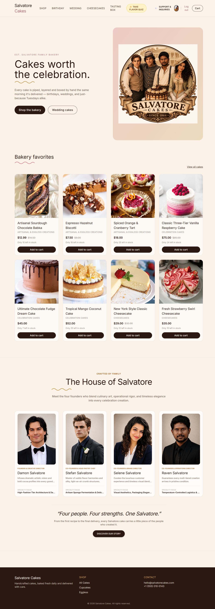
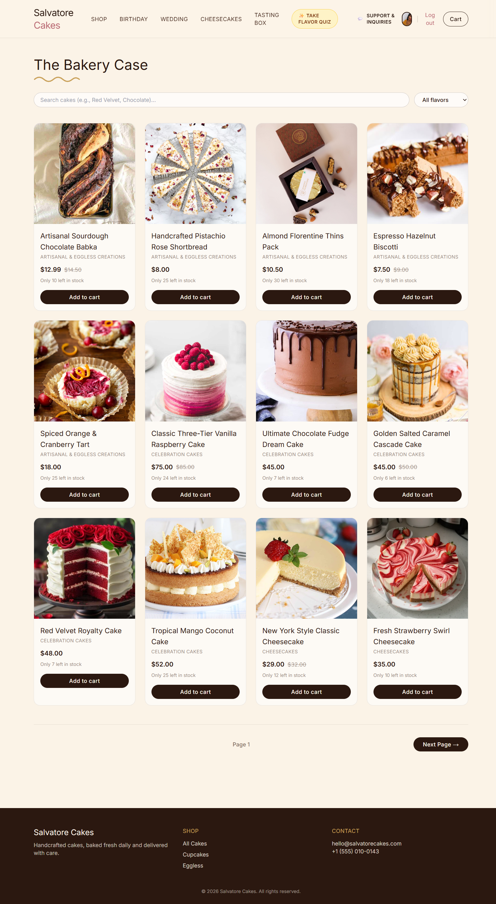
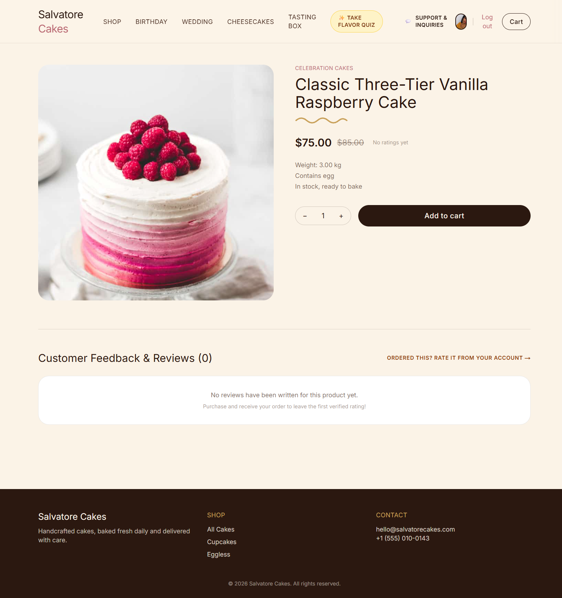
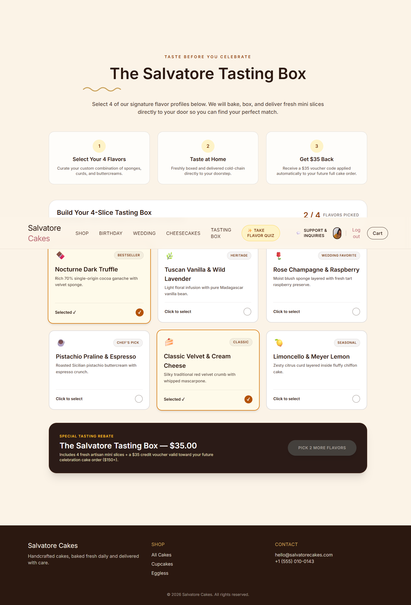
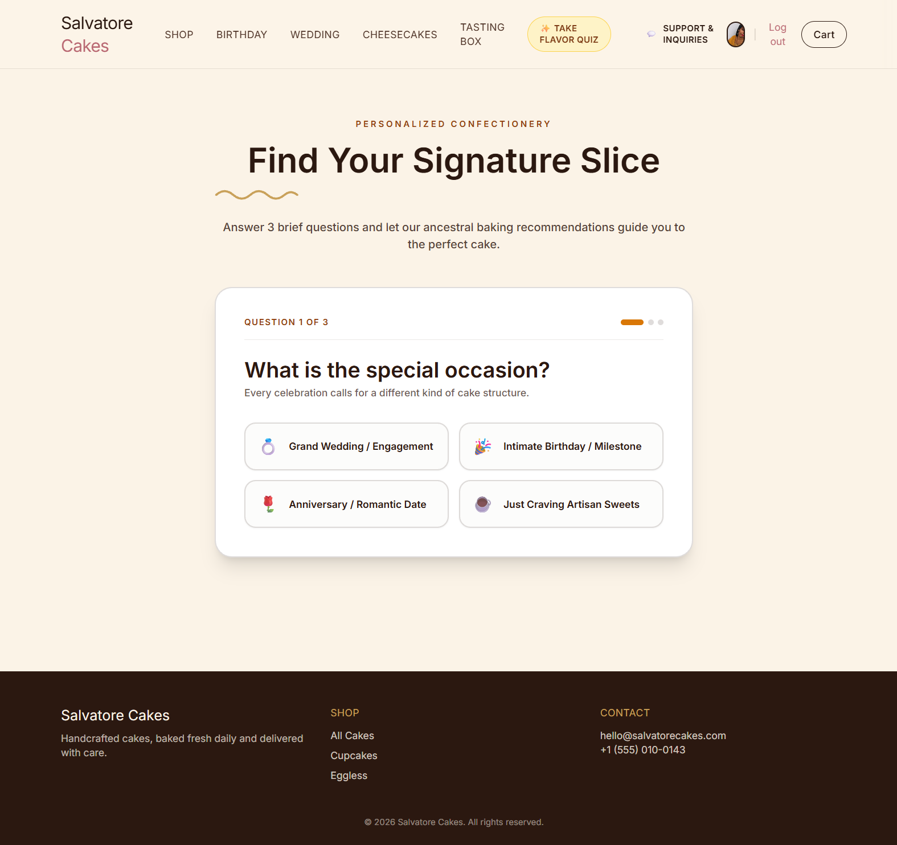
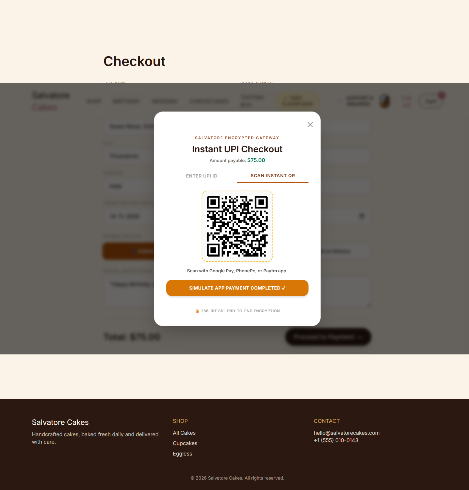
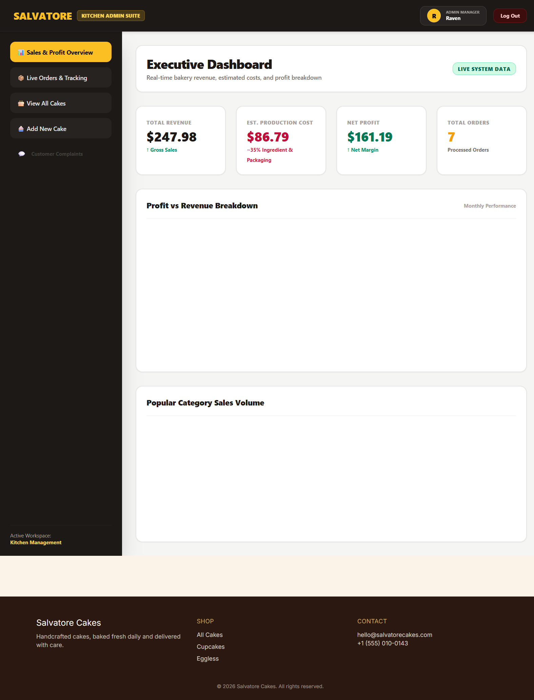
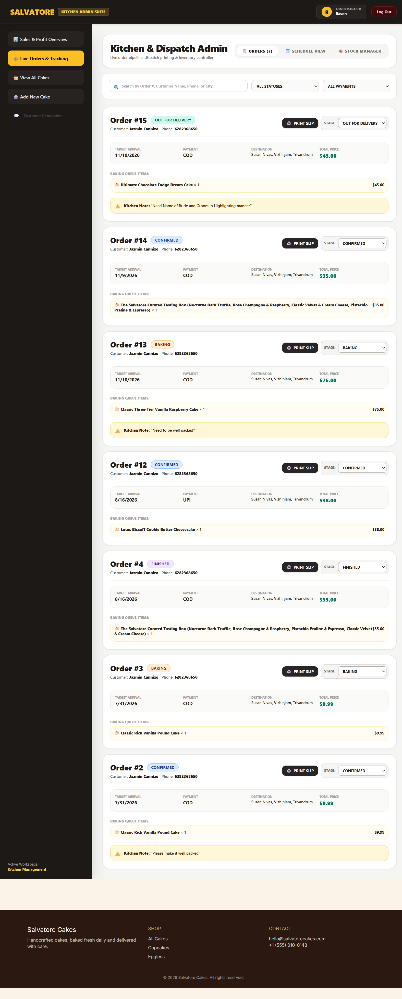

# 🎂  Salvatore Cakes


> **Handcrafted cakes, baked fresh daily and delivered with care.**
> A full-stack e-commerce platform for an artisan bakery - with tasting boxes,
> a flavor-matching quiz, order tracking, and a complete kitchen admin console.


[](https://www.djangoproject.com/)
[](https://www.django-rest-framework.org/)
[](https://nextjs.org/)
[](https://reactjs.org/)
[](https://tailwindcss.com/)
[](https://jwt.io/)

---

## 📋 Table of Contents

- [Overview](#-overview)
- [Features](#-features)
- [Tech Stack](#-tech-stack)
- [Screenshots](#-screenshots)
- [Project Structure](#-project-structure)
- [Getting Started](#-getting-started)
- [Environment Variables](#-environment-variables)
- [API Overview](#-api-overview)
- [Deployment](#-deployment)
- [Roadmap](#-roadmap)
- [License](#-license)
- [Author](#-author)

---

## 🌿 Overview

**Salvatore Cakes** is a full-stack bakery e-commerce platform built around the fictional Salvatore family (est. 1864). It's designed to feel like a **luxury artisan bakery** - warm espresso, cocoa, and gold tones, with hand-crafted UX touches like a tasting box builder, a flavor-finder quiz, and a live order-tracking timeline.

The project demonstrates **production-grade patterns**:
- Server-side price & stock integrity (no client-controlled pricing)
- Atomic stock decrement (no overselling)
- JWT authentication with role-based permissions
- Order confirmation emails via signals
- Optimized queries (N+1 free)
- Complete admin console with analytics, inventory, and print slips

---

## ✨ Features

### 🛍️ Customer Experience
- **Browse** 40 artisan products across 8 categories
- **Live Search** with instant autocomplete suggestions
- **Filter** by category, flavor, and price
- **Product detail** pages with images, reviews, and ratings
- **Persistent cart** across page loads (localStorage)
- **Checkout** with UPI / Card / Cash-on-Delivery
- **Order tracking** with a live status timeline
- **Tasting Box builder** - pick exactly 4 flavors for a curated sampler
- **Flavor Finder Quiz** - 3 questions, matched to a real product
- **Reviews** with star rating
- **Support tickets** with admin replies
- **Profile management** with avatar upload


### 👑 Admin Console
- **Sales dashboard** with revenue & profit charts (Recharts)
- **Live order pipeline** with status updates
- **Printable kitchen slips** for baking queue
- **Inventory manager** with one-tap stocks adjustments
- **Product CRUD** with reply + status tracking
- **Delivery calendar** grouped by bake date


### 🔒 Security & Data Integrity
-**JWT Authentication** (access + refresh tokens, tab-isolated)
- **Server-side pricing** - prices come from the DB, not the client
- **Atomic transactions** - stock decremented in a row lock
- **No user enumeration** on password reset
- **OTP rate limiting** (5 attempts / 5 min)
- **Duplicate email prevention**
- **Role-based permissions** - customers vs. staff vs. superuser
- **Anonymous write/delete blocked** on all product endpoints

---

## 🧰 Tech Stack

### Backend
| Layer | Technology |
|---|---|
| Framework | Django 5.0.6 |
| API | Django REST Framework 3.15.1 |
| Auth | SimpleJWT 5.3.1 |
| Filters | django-filter 24.2 |
| CORS | django-cors-headers 4.3.1 |
| Images | Pillow 10.3.0 |
| Config | python-decouple 3.8 |
| Server | Gunicorn (production) |
| Static | WhiteNoise |


### Frontend
| Layer | Technology |
|---|---|
| Framework | Next.js 14 (App Router) |
| UI | React 18.3.1 |
| Styling | Tailwind CSS 3.4.4 |
| HTTP | Axios 1.7.2 |
| Charts | Recharts |
| Toasts | Sonner |
| Fonts | Fraunces (display) + Inter (body) |


### Infrastructure
- **Database:** SQLite (dev), Postgres-ready (prod)
- **Email:** Gmail SMTP (dev), swap to SendGrid/Postmark (prod)
- **Frontend hosting:** Vercel
- **Backend hosting:** Render / Railway

---


## 📸 Screenshots

### 🏠 Homepage


### 🛍️ Shop - Filter & Search


### 🍰 Product Detail with Reviews


### 🎁 Tasting Box Builder


### ✨ Flavor Finder Quiz


### 💳 Checkout with Payment Modal


### 👑 Kitchen Admin Dashboard


### 📋 Live Order Pipeline


**Quick capture tip:** use the Windows **Snipping Tool** (`Win + Shift + S`), save to `./screenshots/` folder at the repo root, uncomment the block above.

---

## 📁 Project Structure

salvatore-cakes/
├── backend/ # Django REST API
│ ├── accounts/ # Auth, profiles, password reset
│ ├── products/ # Categories, products, seed command
│ ├── orders/ # Orders, order items, email signals
│ ├── feedback/ # Reviews
│ ├── complaints/ # Support tickets
│ ├── config/ # Settings, URLs, WSGI
│ ├── requirements.txt
│ ├── Procfile # Gunicorn for production
│ ├── .env.example # Environment template
│ └── manage.py
│
└── frontend/ # Next.js app
├── app/ # App Router routes
│ ├── admin/ # Kitchen admin console
│ ├── product/ # Product detail
│ ├── shop/ # Shop + filters
│ ├── cart/ # Cart
│ ├── checkout/ # Checkout + payment
│ ├── profile/ # User profile
│ ├── tasting-box/ # Tasting box builder
│ ├── flavor-finder/ # Quiz
│ └── ...
├── components/ # Reusable UI (Navbar, ProductCard, etc.)
├── lib/ # API clients, constants, helpers
├── package.json
└── .env.example

---

## 🚀 Getting Started

### Prerequisites
- **Python 3.11+**
- **Node.js 18.17+** (Next.js 14 minimum)
- **npm** or **yarn**
- **Git**


### 1️⃣ Clone the repository

```bash
git clone https://github.com/your-username/salvatore-cakets.git
cd salvatore-cakes
```


### 2️⃣ Backend Setup

```bash
cd backend

# Create and activate a virtual environment
python -m venv .venv
# Windows:
.venv\Scripts\activate
# Mac/Linux:
source .venv/bin/activate

# Install dependencies
pip install -r requirements.txt

# Copy environment template
copy .env.example .env    # Windows
cp .env.example .env      # Mac/Linux


# Edit .env and fill in:
#   SECRET_KEY             (generate below)
#   EMAIL_HOST_USER        (your Gmail address)
#   EMAIL_HOST_PASSWORD    (Gmail app password - see below)


# Generate a SECRET_KEY:
python -c "from django.core.management.utils import get_random_secret_key; print(get_random_secret_key())"

# Run migrations
python manage.py migrate

# Seed the database with 40 products + 8 categories
python manage.py seed_products

# Create an admin user (for /admin console)
python manage.py createsuperuser

# Start the backend
python manage.py runserver
```

**Backend runs at:** http://localhost:8000


### 3️⃣ Frontend Setup

```bash
cd frontend

# Install dependencies
npm install

# Copy environment template
copy .env.example .env.local     # Window
cp .env.example .env.local     # Mac/Linux

# The default NEXT_PUBLIC_API_URL=http://localhost:8000/api
# works for local dev. Change if backend is elsewhere.

# Start the frontend
npm run dev
```

**Frontend runs at:** http://localhost:3000